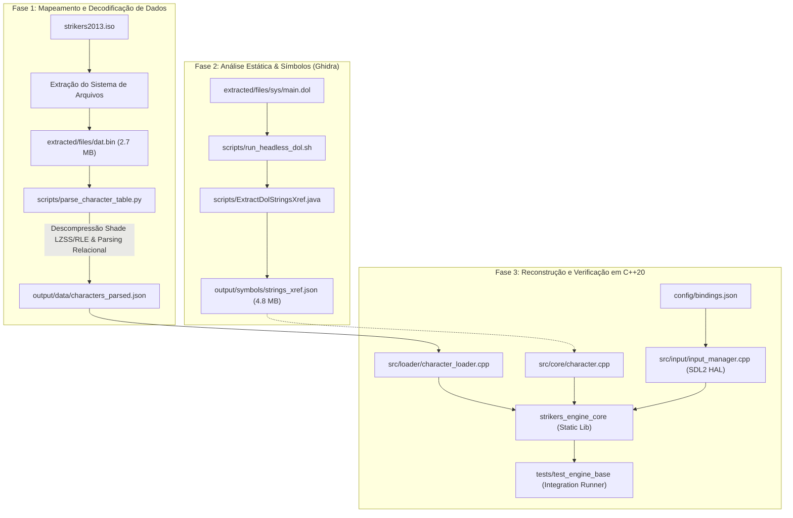
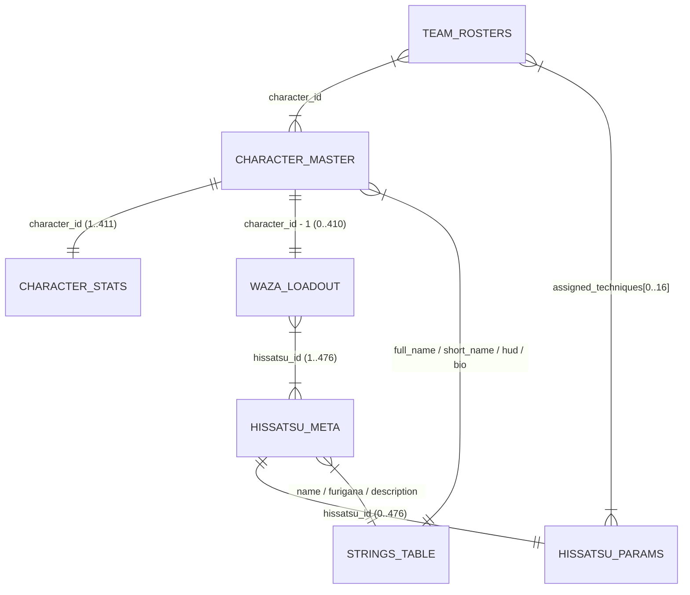

# ⚡ Inazuma Eleven GO Strikers 2013 — REA & Modern Engine Core

[](https://en.cppreference.com/w/cpp/20)
[](https://cmake.org/)
[](https://www.libsdl.org/)
[](https://ghidra-sre.org/)
[](https://www.python.org/)
[](#)
[](#)
[](LICENSE)

> **Projeto de Engenharia Reversa (Reverse Engineering & Architecture — REA)** e reconstrução modular da engine de *Inazuma Eleven GO Strikers 2013* (Nintendo Wii, Level-5 / Shade) para arquiteturas modernas de 64 bits utilizando **C++20 estrito**, **SDL2** e um pipeline automatizado de ingestão de dados binários.

---

## 📌 Visão Geral e Proposta de Valor

O objetivo deste projeto é documentar exaustivamente as estruturas de dados, mecânicas de duelo, formatos binários e controle de fluxo do executável original em PowerPC (`main.dol`), recriando o motor de jogo em C++ moderno, portável, testável e livre das dependências de hardware legado do Nintendo Wii.

Este projeto demonstra competências avançadas em:
- **Engenharia Reversa de Baixo Nível (SRE):** Análise estática automatizada via *Ghidra Headless*, decodificação de instruções PowerPC 750CL (Broadway) e mapeamento de ponteiros, funções e símbolos.
- **Decodificação de Formatos Binários Proprietários:** Engenharia reversa dos contêineres `.bin` e implementação do algoritmo de descompressão proprietário híbrido **LZSS/RLE** da engine Shade (`0x80333C5C`).
- **Tratamento de Endianness Cruzada:** Conversão determinística de estruturas binárias nativas em Big-Endian (`>`) do Wii para esquemas Little-Endian (`<`) compatíveis com arquiteturas x86_64/ARM64.
- **Desenvolvimento Moderno em C++20:** Domínio orientado a dados (*Data-Driven Design*), abstração de entrada (*Hardware Abstraction Layer - HAL*) sobre SDL2, uso de *strong enums*, tipos semânticos e ausência de *leaks*.
- **Arquitetura Orientada a Testes (TDD/Integration):** Verificação automatizada garantindo paridade numérica de 100% dos dados originais (411 personagens instanciados e 476 técnicas Hissatsu catalogadas).

---

## 🏗️ Plataforma de Origem vs. Plataforma Alvo

| Propriedade | Plataforma de Origem (Nintendo Wii) | Plataforma Alvo (Reconstrução) |
| :--- | :--- | :--- |
| **Código do Jogo / Região** | `RVL-R5GJ-JPN` (Japão) | Independente de Região |
| **Processador / ISA** | PowerPC 750CL (Broadway) 32-bit | x86_64 / ARM64 moderno |
| **Endianness** | Big-Endian (`>`) | Little-Endian (`<`) |
| **Executável Base** | `sys/main.dol` (PowerPC Baremetal ELF) | Binário ELF nativo C++20 |
| **Armazenamento de Dados** | Contêineres Level-5 / Shade (`dat.bin`, LZSS/RLE) | Schemas estruturados JSON / Ingestão Binária |
| **Sub-sistema de Entrada** | WPAD / PAD (Wiimote, Nunchuk, Classic Controller) | Abstração Agnóstica via SDL2 (Teclado + Gamepads) |

---

## 🧩 Pipeline de Arquitetura do Sistema

O fluxo de engenharia reversa e reconstrução foi estruturado em três fases complementares e determinísticas:



---

## 📊 Modelo de Domínio e Relacionamentos Binários

A partir da decodificação do contêiner `dat.bin` e suas 130 seções indexadas (65 pares espelhados Big-Endian / Little-Endian), reconstruiu-se a topologia relacional do motor de jogo:



### Principais Entidades Mapeadas:
- **411 Personagens Únicos:** Incluindo Endou Mamoru, Gouenji Shuuya, Kidou Yuuto, Tsurugi Kyousuke, Matsukaze Tenma e variantes clássicas/GO.
- **476 Técnicas Hissatsu:** Categorizadas em Chute (*Shoot*), Drible (*Dribble*), Bloqueio (*Block*), Defesa de Goleiro (*Catch*) e Hissatsu Tactics / Keshin, com consumo de TP, níveis de evolução e requisitos de cooperação (1P a 3P).
- **Atributos de Performance:** Valores base e máximos de TP, Kick, Catch, Body, Control, Guard, Speed, bônus de ativação de Keshin e taxa de geração de Inazuma Gauge.

---

## 🎮 Camada de Entrada Abstrata (Input HAL)

A camada de entrada original do Wii (`WPAD` e `PAD`) foi totalmente desacoplada através do subsistema em `src/input/`:
- **Máscara Lógica Unificada (`LogicalAction`):** Ações de jogo como `PassSwitch`, `ShootSlide`, `DribbleSpecial`, `DashSprint`, `HissatsuLevel` e `TacticSwitch` operam independentemente do periférico.
- **Mapeamento Flexível via JSON (`config/bindings.json`):** Permite remapeamento dinâmico e suporte para até **4 jogadores simultâneos**.
- **Agnóstico de Hardware:** Suporte simultâneo a teclado (WASD / setas) e controles físicos (Xbox, DualShock/DualSense, Nintendo Switch Pro Controller ou Gamepads genéricos) através de **SDL2 GameController API**.

---

## 📁 Estrutura do Repositório

```text
strikers-ai-core/
├── CMakeLists.txt              # Configuração CMake (C++20, flags rigorosas -Wall -Wextra -pedantic)
├── specs/                      # Especificações de Engenharia Reversa (SDD / Schemas)
│   ├── ARCHITECTURE.md         # Documento mestre de arquitetura e decisões de projeto
│   ├── CHARACTERS_SCHEMA.md    # Especificação binária exaustiva de dat.bin e algoritmos
│   ├── INPUT.md                # Contrato e arquitetura da camada de input SDL2
│   └── AGENTS.md               # Diretrizes operacionais e papéis de engenharia
├── src/                        # Código-fonte da Engine Reconstruída (C++20)
│   ├── core/                   # Modelos de domínio (Character, Hissatsu, Atributos)
│   ├── input/                  # Abstração de hardware, bindings JSON e SDL2 Input Manager
│   └── loader/                 # Ingestão de dados estruturados e catálogos em memória
├── scripts/                    # Scripts de Engenharia Reversa e Automação
│   ├── parse_character_table.py# Descompressor LZSS/RLE e parser das tabelas relacionais
│   ├── run_headless_dol.sh     # Wrapper de execução automatizada do Ghidra Headless
│   ├── ExtractDolStringsXref.java# Script Java para extração de strings e XRefs do main.dol
│   └── scan_headers.py         # Scanner de magic bytes e contêineres na ISO
├── config/
│   └── bindings.json           # Mapeamento configurável de controles (P1-P4)
├── tests/
│   └── test_engine_base.cpp    # Suíte de verificação da engine, catálogo e simulação de input
└── output/
    ├── data/                   # Datasets JSON estruturados (characters_parsed.json)
    └── symbols/                # Dumps de símbolos e referências cruzadas descompiladas
```

---

## 🚀 Como Compilar e Executar

### Pré-requisitos
- **Compilador C++20:** GCC 11+ ou Clang 13+
- **CMake:** Versão 3.20 ou superior
- **Bibliotecas:** `libsdl2-dev`
- **Python 3:** 3.10+ (para execução de parsers)

Em distribuições baseadas em Debian/Ubuntu:
```bash
sudo apt update
sudo apt install build-essential cmake libsdl2-dev python3
```

### Compilação do Projeto

```bash
# 1. Clonar o repositório
git clone https://github.com/SEU_USUARIO/strikers-ai-core.git
cd strikers-ai-core

# 2. Configurar a build com CMake
cmake -B build -DCMAKE_BUILD_TYPE=Release

# 3. Compilar a biblioteca de domínio e a suíte de testes
cmake --build build -j$(nproc)
```

### Execução dos Testes de Integração

O executável de teste valida a inicialização do subsistema de input SDL2, carrega e valida os 411 personagens e 476 técnicas, e simula um loop de amostragem de frames com entradas de teclado e gamepad:

```bash
# Executar a suíte de testes
./build/tests/test_engine_base
```

*Saída de exemplo:*
```text
======================================================================
  Inazuma Eleven GO Strikers 2013 - Teste de Base do Motor (C++20)
======================================================================

[1/3] Inicializando SDL2 (v2.30.0) e InputManager...
  - Mapeamentos carregados de : config/bindings.json
  - Perfil P1                 : Player 1 (Keyboard WASD + Gamepad 0)

[2/3] Carregando e validando catalogo de dominio: output/data/characters_parsed.json...
  - Jogo                      : Inazuma Eleven GO Strikers 2013 (RVL-R5GJ-JPN)
  - Personagens instanciados  : 411 (esperado: 411)
  - Tecnicas Hissatsu         : 476 (esperado: 476)
  - Distribuicao por Posicao  : GK=86, DF=101, MF=115, FW=109, Manager=0
  - Distribuicao por Elemento : Wind=147, Wood=115, Fire=87, Mountain=62

[3/3] Executando mini loop de polling da SDL2 (8 quadros)...
  [Frame 1] P1 Axis=( 0.71, -0.71) | Held=0x1281 | Pressed=0x1281 [+PASS]
  [Frame 2] P1 Axis=( 0.71, -0.71) | Held=0x130e | Pressed=0x010e [+SHOOT] [+DRIBBLE] [+DASH]

[SUCESSO] Todos os testes de dominio e subsistema de entrada SDL2 passaram sem erros!
```

---

## 🛠️ Tecnologias e Ferramentas Utilizadas

- **Linguagem Principal:** C++20 (conceitos, inicialização uniforme, *smart pointers*, `std::span`, `std::string_view`)
- **Build System:** CMake com flags de rigor técnico (`-Wall -Wextra -pedantic`)
- **Hardware Abstraction Layer:** SDL2 (Simple DirectMedia Layer)
- **Serialização e Schemas:** `nlohmann/json`
- **Engenharia Reversa Estática:** Ghidra SRE (NSA) em modo Headless com scripts de automação em Java
- **Engenharia de Dados & Parsing Binário:** Python 3 (`struct`, `lzss`, `rle`, `endianness`)

---

## 🗺️ Roadmap de Desenvolvimento

- [x] **Fase 1: Extração e Decodificação de Contêineres**
  - [x] Descompressor LZSS/RLE proprietário da Shade Engine.
  - [x] Parser de tabelas relacionais (`characters`, `hissatsu`, `stats`, `strings`, `rosters`).
  - [x] Exportação de schema consolidado em JSON.
- [x] **Fase 2: Análise Estática de Executável (`main.dol`)**
  - [x] Configuração do pipeline de descompilação automatizada com Ghidra Headless.
  - [x] Mapeamento de tabelas de símbolos e strings cruzadas (XRefs).
- [x] **Fase 3: Núcleo do Motor em C++20**
  - [x] Implementação de tipos de domínio fortemente tipados (`Character`, `HissatsuTechnique`).
  - [x] Catálogo e carregador assíncrono em memória.
  - [x] Sistema de abstração de entrada multi-jogador SDL2 com bindings JSON.
  - [x] Suíte de testes de integração automatizada.
- [ ] **Fase 4: Lógica de Partida e Inteligência Artificial (Próximos Passos)**
  - [ ] Implementação das fórmulas matemáticas de duelo de chute vs defesa e divididas.
  - [ ] Máquina de estados finitos (FSM) de movimentação tática dos atletas.
  - [ ] Simulação de física 3D simplificada da bola em campo.

---

## 📄 Licença

Este projeto é disponibilizado sob a licença [MIT](LICENSE). Consulte o arquivo [LICENSE](LICENSE) para mais detalhes sobre os termos de uso do código e o aviso legal de engenharia reversa limpa (*clean-room*).
