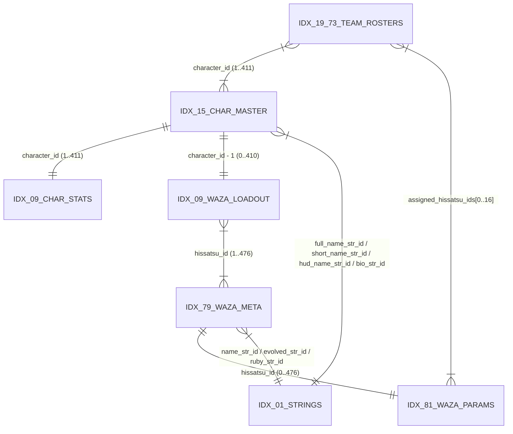

# Schema Binário de Personagens, Atributos e Técnicas (`CHARACTERS_SCHEMA.md`)

**Alvo:** *Inazuma Eleven GO Strikers 2013* (Wii — `RVL-R5GJ-JPN`, Engine Shade / Level-5)  
**Contêiner Primário:** `extracted/files/dat.bin`  
**Script Decodificador:** `scripts/parse_character_table.py`  
**Saída Estruturada:** `output/data/characters_parsed.json`

---

## 1. Arquitetura do Contêiner `dat.bin` e Descompressão Shade LZSS/RLE

O arquivo `extracted/files/dat.bin` (`2.707.456` bytes) armazena **130 sub-arquivos** (`65` pares espelhados) indexados por um cabeçalho de 20 bytes (`0x00..0x13`) seguido por `130` descritores de 32 bits em `0x14..0x21B`.

| Offset | Tipo | Nome | Valor / Fórmula | Descrição |
| :--- | :--- | :--- | :--- | :--- |
| `0x00` | `uint32` | `entry_count` | `130` (`0x82`) | Total de sub-arquivos no contêiner (`65` pares LE/BE). |
| `0x04` | `uint32` | `offset_align` | `0x800` (`2048`) | Alinhamento de setor em bytes de cada sub-arquivo. |
| `0x08` | `uint32` | `size_mult` | `0x20` (`32`) | Multiplicador de bloco para o tamanho alocado. |
| `0x0C` | `uint32` | `bit_shift` | `17` (`0x11`) | Deslocamento de bits para extrair o índice de setor (`desc >> 17`). |
| `0x10` | `uint32` | `bit_mask` | `0x1FFFF` | Máscara de bits para extrair o tamanho em blocos (`desc & 0x1FFFF`). |
| `0x14 + 4*i` | `uint32` | `descriptor[i]` | `offset = (d >> 17) * 0x800` `size = (d & 0x1FFFF) * 0x20` | Descritor empacotado do sub-arquivo `i` (`0 <= i < 130`). |

### Convenção de Endianness e IDs Virtuais (`0x9C40 + idx`)
- **Índices Pares (`0, 2, ..., 128`)**: Espelhos em *Little-Endian* (`<`) gerados pelo pipeline da Shade.
- **Índices Ímpares (`1, 3, ..., 129`)**: Tabelas nativas do Nintendo Wii em **Big-Endian (`>`)**, carregadas em tempo de execução por `main.dol` através do ID de arquivo virtual **`0x9C40 + idx`**.
- **Validação de Integridade Cruzada**: Para todos os 65 pares `(2k, 2k+1)`, o tamanho descomprimido do bloco par é idêntico ao do bloco ímpar (`len(decompress(2k)) == len(decompress(2k+1))`).

### Algoritmo de Descompressão Shade LZSS/RLE (`main.dol` @ `0x80333C5C`)
Cada sub-arquivo de `dat.bin` é um fluxo comprimido codificado por bytes de comando (`cmd`):
1. `cmd == 0x00`: Fim do fluxo comprimido.
2. `cmd & 0x80 != 0` (**Referência LZSS**):
   - `count = ((cmd >> 5) & 0x03) + 4`
   - `offset = ((cmd & 0x1F) << 8) | next_byte` (distância retroativa `1..8191` bytes no buffer de saída)
   - Enquanto o byte seguinte tiver máscara `(b & 0xE0) == 0x60`, copia mais `b & 0x1F` bytes consecutivos da mesma janela.
3. `cmd & 0x40 != 0` (**Repetição RLE**):
   - Se `cmd & 0x10 != 0`, `count = (((cmd & 0x0F) << 8) | next_byte) + 4`; caso contrário, `count = (cmd & 0x0F) + 4`.
   - Lê `1` byte de valor e repete-o `count` vezes.
4. `cmd & 0xC0 == 0` (**Sequência Literal**):
   - Se `cmd & 0x20 != 0`, `count = ((cmd & 0x1F) << 8) | next_byte`; caso contrário, `count = cmd & 0x1F`.
   - Copia `count` bytes literais diretamente para a saída.

---

## 2. Diagrama Relacional das Tabelas em `dat.bin`

---

## 3. Cabeçalho Padrão de Tabela Relocável (Big-Endian `>`)

Todas as tabelas ímpares descomprimidas de `dat.bin` iniciam com o cabeçalho de seções relocáveis validado por `RelocatableTableHeader`:

| Offset | Tipo (`struct`) | Campo | Validação / Descrição |
| :--- | :--- | :--- | :--- |
| `+0x00` | `>I` (`uint32`) | `section_count` | Número de seções lógicas ($N$) na tabela. |
| `+0x04` | `>I` (`uint32`) | `reloc_table_offset` | Offset em bytes (alinhado a 4 bytes) para a tabela de relocação de ponteiros no final do arquivo. |
| `+0x08` | `>I` (`uint32`) | `first_section_offset` | Deve ser exatamente igual a `0x0C + section_count * 8`. |
| `+0x0C + 8*i` | `>II` (`2x uint32`) | `sections[i]` | Par `(byte_offset, entry_count)` definindo o início e o número de registros da seção `i`. |

---

## 4. Tabela Mestre de Strings (`idx = 1` / Virtual ID `0x9C41`)

- **Tamanho Descomprimido:** `466.164` bytes (`0x71CF4`)
- **Codificação de Texto:** **Shift-JIS (`CP932`)** terminado em nulo (`0x00`).
- **Seções:**
  - `sec[0]` (`offset = 0x1C`, `count = 49`, stride = `8` bytes): Prefixos de formatação de texto.
  - `sec[1]` (`offset = 0x42C`, `count = 7579`, stride = `4` bytes): Array de `7.579` ponteiros Big-Endian (`>I`) para strings Shift-JIS.

### Faixas de IDs de Strings (`str_id`) Utilizadas por Personagens e Técnicas
| Intervalo `str_id` | Marcador Inicial | Conteúdo | Exemplo |
| :--- | :--- | :--- | :--- |
| `1316 .. 1692` | `1315` (`@キャラ説明`) | Biografias/descrições de personagens | `str[1316]`: Bio de Endo Mamoru |
| `4981 .. 6152` | `4980` (`@必殺技名称`) | Nomes de técnicas Hissatsu, evoluções (`改`, `真`, `V2`, `G2`) e leitura | `str[5063]`: `"ゴッドハンド"` |
| `6154 .. 6487` | `6153` (`@選手名`) | Nomes completos com marcação de furigana | `str[6154]`: `"#Rx10#R#=円堂(えんどう)　#R守(まもる)"` |
| `6489 .. 6827` | `6488` | Nomes curtos de exibição | `str[6489]`: `"えんどう"` |
| `6828 .. 7235` | `6827` | Nomes qualificados por versão/time (HUD / Clubroom) | `str[6828]`: `"えんどう（雷門）"` |
| `7237 .. 7263` | `7236` (`@チーム名称`) | Nomes de times | `str[7237]`: `"雷門"` |

### Sintaxe de Marcação de Furigana (Shade Engine)
As strings de nomes completos e biografias utilizam tags de controle `#R`:
- `#Rx10`, `#Rx9`, `#Rm-3`: Tags de espaçamento/escala de fonte.
- `#R#=Kanji(Leitura)` ou `#RKanji(Leitura)`: Define o texto principal (`Kanji`) e sua leitura em hiragana (`Leitura`) exibida acima do kanji.

---

## 5. Character Master Table (`idx = 15` / Virtual ID `0x9C4F`)

- **Carregamento em `main.dol`:** `0x800099C4` (`mulli r28, r0, 0x148` em `0x800099E0`).
- **Tamanho Descomprimido:** `138.816` bytes (`0x21E40`).
- **Seções:**
  - `sec[0]` (`offset = 0xE5C`, `count = 412`, **stride = `328` bytes / `0x148`**): Registros mestres de personagens (`0` = registro dummy nulo; `1..411` = `411` variantes de personagens jogáveis/chefes/managers).
  - `sec[1]` (`offset = 0x1C`, `count = 38`, **stride = `96` bytes / `0x60`**): Definições de kits/uniformes de times.

### Layout Completo do Registro de Personagem (`328` bytes / `0x148`, Big-Endian `>`)

| Offset | Tipo (`struct`) | Campo | Descrição Detalhada |
| :--- | :--- | :--- | :--- |
| `+0x000` | `>I` (`uint32`) | `character_id` | ID único da variante do personagem (`1..411`). |
| `+0x004` | `>I` (`uint32`) | `runtime_team_slot` | `0` em disco; preenchido em RAM (`main.dol` @ `0x80009FD8`) com o índice do jogador no time. |
| `+0x008` | `>I` (`uint32`) | `hud_name_str_id` | Índice em `idx=1` `sec[1]` para o nome qualificado por versão/time (ex.: `6828` = `"えんどう（雷門）"`). |
| `+0x00C` | `>I` (`uint32`) | `short_name_str_id` | Índice em `idx=1` `sec[1]` para o nome curto no placar/HUD (ex.: `6489` = `"えんどう"`). |
| `+0x010` | `>I` (`uint32`) | `full_name_str_id` | Índice em `idx=1` `sec[1]` para o nome completo com furigana (ex.: `6154` = `"円堂 守"`). |
| `+0x014` | `32s` (`ASCII`) | `model_code` | Código ASCII de 32 bytes do modelo 3D (ex.: `"P_0001ENDO"`, `"P_0002KAZEMARU_IJ"`, `"P_10010TSURUGI"`). |
| `+0x034` | `>I` (`uint32`) | `grade_or_category` | Categoria etária / série escolar (`0..4`). |
| `+0x038` | `>I` (`uint32`) | `bio_str_id` | Índice em `idx=1` `sec[1]` para a descrição/biografia do personagem (`1316..1692`). |
| `+0x03C` | `>I` (`uint32`) | `reserved_3c` | Flag auxiliar de perfil (`0` ou `1`). |
| `+0x040` | `>I` (`uint32`) | `model_scale_a` | Escala vertical base do modelo em milésimos (ex.: `1000` = `1.000x`, `1125` = `1.125x`). |
| `+0x044` | `>I` (`uint32`) | `model_scale_b` | Escala de largura/proporção de tronco (ex.: `525`, `705` para Kabeyama). |
| `+0x048` | `>I` (`uint32`) | `head_size_param` | Parâmetro de proporção de cabeça (`20..25`). |
| `+0x04C` | `>I` (`uint32`) | `body_type_id` | Tipo físico do esqueleto: `0` = Normal, `1` = Pequeno/Feminino, `2` = Grande/Pesado. |
| `+0x050` | `>I` (`uint32`) | `team_affiliation_flag_1` | ID do time primário de origem (`1` = Raimon, `14` = Shinsei Raimon, etc.). |
| `+0x054` | `>I` (`uint32`) | `team_affiliation_flag_2` | ID do uniforme/time secundário vinculado a `idx=15` `sec[1]`. |
| `+0x058` | `>I` (`uint32`) | `skin_variant` | Variante de textura facial/expressão (`0..9`). |
| `+0x05C` | `>I` (`uint32`) | `position_id` | Posição em campo (`main.dol` @ `0x80009EF4`): • `0` ou `34` (`0x22`) = **GK (Goalkeeper)** • `35` (`0x23`) = **DF (Defender)** • `36` (`0x24`) = **MF (Midfielder)** • `37` (`0x25`) = **FW (Forward)** • `38` (`0x26`) = **Manager / Coach** |
| `+0x060` | `>I` (`uint32`) | `anim_skeleton_group` | ID do conjunto de animações base do personagem. |
| `+0x064` | `>I` (`uint32`) | `model_grp_id_1` | Índice do arquivo de modelo 3D principal em `grp.bin` (ex.: `2481` = `0x09B1`). |
| `+0x068` | `>I` (`uint32`) | `model_grp_id_2` | Índice do arquivo de modelo 3D secundário/LOD em `grp.bin`. |
| `+0x06C` | `>I` (`uint32`) | `runtime_kit_ptr_1` | Preenchido em tempo de execução (`main.dol` @ `0x80009BF0`). |
| `+0x070` | `>I` (`uint32`) | `runtime_kit_ptr_2` | Preenchido em tempo de execução (`main.dol` @ `0x80009BE8`). |
| `+0x074` | `>I` (`uint32`) | `default_jersey_number` | Número padrão da camisa do jogador (`1` para Endo, `2` para Kazemaru, `10` para Gouenji/Tsurugi). |
| `+0x078` | `>I` (`uint32`) | `face_icon_grp_id` | Índice em `grp.bin` do ícone 2D de rosto (`0x7AB3` = `31411` para Endo). |
| `+0x07C` | `>I` (`uint32`) | `runtime_roster_slot` | Slot preenchido em tempo de execução (`main.dol` @ `0x80009FB8`). |
| `+0x080` | `>I` (`uint32`) | `bust_up_grp_id_1` | Índice em `grp.bin` da textura de busto/cut-in 1 (`31818`). |
| `+0x084` | `>I` (`uint32`) | `bust_up_grp_id_2` | Índice em `grp.bin` da textura de busto/cut-in 2 (`31833`). |
| `+0x088` | `24s` (`ASCII`) | `socks_model_code` | Código ASCII de 24 bytes do modelo de meião (ex.: `"sock_02"`, `"sock_04"`, ou vazio `""` para padrão). |
| `+0x0A0` | `32s` (`ASCII`) | `foot_model_code` | Código ASCII de 32 bytes do modelo de chuteira (ex.: `"foot_01"`, `"foot_02"`). |
| `+0x0C0..+0x0E7` | `10x >I` | `reserved_c0_e7` | Bloco reservado (`0` em disco). |
| `+0x0E8` | `>I` (`uint32`) | `skin_color_rgba_1` | Cor primária de pele/sombreamento (ex.: `0x00CE9343`). |
| `+0x0EC` | `>I` (`uint32`) | `skin_color_rgba_2` | Cor secundária de pele/iluminação (ex.: `0x00E1B084`). |
| `+0x0F0` | `>I` (`uint32`) | `base_person_id` | ID da pessoa-base que agrupa variantes do mesmo personagem (ex.: `1` para todas as variantes jovens de Endo, `2` para Kazemaru, `10` para Gouenji, `10010` para Tsurugi). |
| `+0x0F4` | `>I` (`uint32`) | `element_id` | Afinidade elemental do personagem: • `0` = **Wind (風 / Kaze)** • `1` = **Wood (林 / Hayashi)** • `2` = **Fire (火 / Hi)** • `3` = **Mountain (山 / Yama)** |
| `+0x0F8` | `>I` (`uint32`) | `age_or_grade_group` | Grupo de voz/idade (`1..40`). |
| `+0x0FC` | `>I` (`uint32`) | `reserved_fc` | Reservado (`0`). |
| `+0x100` | `>I` (`uint32`) | `body_build_group` | Grupo de porte de colisão/animação (`0..3`). |
| `+0x104` | `>I` (`uint32`) | `voice_table_index` | Índice base na tabela de vozes (`idx = 103` / `0x9CA7`). |
| `+0x108..+0x11F` | `6x >I` | `flags_and_voice_bank` | Metadados de banco de áudio e flags de desbloqueio (`+0x110`, `+0x114`, `+0x118`). |
| `+0x120..+0x147` | `20x >H` | `runtime_team_waza_buf` | Buffer de 40 bytes (`0` em disco) populado em RAM (`main.dol` @ `0x8000A08C..0x8000A160`) com os 17 slots de Hissatsu da tabela de elenco do time (`idx = 19..73`). |

---

## 6. Tabela de Atributos Base/Máx e Loadout de Hissatsu (`idx = 9` / Virtual ID `0x9C49`)

- **Carregamento em `main.dol`:** `0x80009C24` e `0x80027218` (parsers em `0x80026C68` e `0x80026DCC`).
- **Tamanho Descomprimido:** `31.704` bytes (`0x7BD8`).

### 6.1. Seção 0 (`sec[0]`): Atributos Base e Máximos (`offset = 0x3C`, `count = 412`, **stride = `20` bytes / `0x14`**)
Indexada diretamente por `character_id` (`0..411`). O parser em `main.dol` (`0x80026C84..0x80026D0C`) lê cada par `(Base, Max)` de 1 byte (`uint8`):

| Offset | Tipo | Campo | Descrição | Exemplo (`cid=1` Endo) | Exemplo (`cid=23` Gouenji) |
| :--- | :--- | :--- | :--- | :--- | :--- |
| `+0x00` | `uint8` | `tp_base` | TP Inicial (Nível 1) | `100` | `100` |
| `+0x01` | `uint8` | `tp_max` | TP Máximo (Treino Máx) | `160` | `150` |
| `+0x02` | `uint8` | `kick_base` | Chute (Kick) Base | `10` | `30` |
| `+0x03` | `uint8` | `kick_max` | Chute (Kick) Máximo | `50` | `70` |
| `+0x04` | `uint8` | `catch_base` | Defesa GK (Catch) Base | `30` | `10` |
| `+0x05` | `uint8` | `catch_max` | Defesa GK (Catch) Máximo | `90` | `30` |
| `+0x06` | `uint8` | `body_base` | Físico (Body) Base | `20` | `30` |
| `+0x07` | `uint8` | `body_max` | Físico (Body) Máximo | `60` | `70` |
| `+0x08` | `uint8` | `control_base` | Controle (Control) Base | `30` | `30` |
| `+0x09` | `uint8` | `control_max` | Controle (Control) Máximo | `70` | `50` |
| `+0x0A` | `uint8` | `guard_base` | Guarda (Guard) Base | `30` | `20` |
| `+0x0B` | `uint8` | `guard_max` | Guarda (Guard) Máximo | `50` | `60` |
| `+0x0C` | `uint8` | `speed_base` | Velocidade (Speed) Base | `20` | `30` |
| `+0x0D` | `uint8` | `speed_max` | Velocidade (Speed) Máximo | `40` | `50` |
| `+0x0E` | `uint8` | `keshin_stat_bonus` | Bônus de atributo Keshin / Aliea / DE (`0`, `5`, `15`) | `0` | `0` (`5` em Tsurugi) |
| `+0x0F` | `uint8` | `reserved_0f` | Reservado (`0`) | `0` | `0` |
| `+0x10` | `uint8` | `inazuma_gauge_rate` | Taxa base da barra Inazuma (`100`) | `100` | `100` |
| `+0x11..+0x13` | `3x uint8` | `padding` | Alinhamento de 4 bytes (`0, 0, 0`) | `[0, 0, 0]` | `[0, 0, 0]` |

### 6.2. Seção 2 (`sec[2]`): Loadout Intrínseco de Hissatsu (`offset = 0x2138`, `count = 411`, **stride = `48` bytes / `0x30`**)
Indexada por `character_id - 1` (`0..410`, correspondendo a `cid = 1..411`). Contém `24` inteiros de 16 bits Big-Endian (`>24H`) representando IDs de técnicas Hissatsu (`0` = slot vazio, `1..476` = ID da técnica em `idx=79`/`81`):

| Índices (`uint16`) | Offset Relativo | Grupo de Slots | Descrição (`main.dol` @ `0x80026DCC`) |
| :--- | :--- | :--- | :--- |
| `u16[0 .. 4]` | `+0x00 .. +0x09` | `shoot_slots[0..4]` | Técnicas de Chute (`Lv1`, `Lv2`, `Lv3`, `Alt 1`, `Alt 2`). |
| `u16[5 .. 8]` | `+0x0A .. +0x11` | `dribble_slots[0..3]` | Técnicas de Drible (`Lv1`, `Lv2`, `Lv3`, `Alt`). |
| `u16[9 .. 12]` | `+0x12 .. +0x19` | `block_slots[0..3]` | Técnicas de Bloqueio/Defesa (`Lv1`, `Lv2`, `Lv3`, `Alt`). |
| `u16[13 .. 16]` | `+0x1A .. +0x21` | `catch_slots[0..3]` | Técnicas de Goleiro/Catch (`Lv1`, `Lv2`, `Lv3`, `Alt`). |
| `u16[17 .. 20]` | `+0x22 .. +0x29` | `special_slots[0..3]` | Slots alternativos/secundários desbloqueáveis. |
| `u16[21]` | `+0x2A` | `special_slots[4]` | **Slot Ultimate / Keshin / Keshin Armed** (ex.: `93` *Great The Hand* para Endo, `357` *Maximum Fire* para Gouenji, `425` *Death Drop [Keshin]* para Tsurugi). |
| `u16[22 .. 23]` | `+0x2C .. +0x2F` | `special_slots[5..6]` | Slots especiais adicionais (`Mixi-Max` / `Keshin`). |

---

## 7. Tabelas de Técnicas Hissatsu (`idx = 79` / `0x9C8F` e `idx = 81` / `0x9C91`)

Ambas as tabelas possuem exatamente **477 entradas** (`wid = 0..476`, onde `0` é o registro nulo e `1..476` são as `476` técnicas do jogo).

### 7.1. Metadados e Referências de Strings (`idx = 79`, `sec[5]`, `offset = 0x336F4`, **stride = `100` bytes / `0x64`**)
| Offset | Tipo (`struct`) | Campo | Descrição |
| :--- | :--- | :--- | :--- |
| `+0x00` | `>I` (`uint32`) | `category_id` | Categoria da técnica: • `0` = **Shoot (シュート)** • `1` = **Dribble (ドリブル)** • `2` = **Block / Defense (ブロック)** • `3` = **Catch / GK (キャッチ)** |
| `+0x04` | `>I` (`uint32`) | `internal_name_offset` | Ponteiro relocado para string Shift-JIS interna dentro de `idx=79`. |
| `+0x08` | `>I` (`uint32`) | `name_str_id` | Índice em `idx=1` `sec[1]` para o nome oficial da técnica (ex.: `5063` = `"ゴッドハンド"`). |
| `+0x0C` | `>I` (`uint32`) | `evolved_str_id` | Índice em `idx=1` `sec[1]` para o nome de evolução/locução. |
| `+0x10` | `>I` (`uint32`) | `ruby_str_id` | Índice em `idx=1` `sec[1]` para a leitura fonética (furigana). |
| `+0x14` | `>I` (`uint32`) | `type_order_index` | Índice de ordenação interna dentro da categoria. |

### 7.2. Parâmetros de Gameplay e Vínculos Co-op (`idx = 81`, `sec[0]`, `offset = 0x1C`, **stride = `140` bytes / `0x8C`**)
| Offset | Tipo (`struct`) | Campo | Descrição |
| :--- | :--- | :--- | :--- |
| `+0x00` | `>H` (`uint16`) | `level_tier_raw` | Nível da técnica (`0` = Nível 1, `1` = Nível 2, `2` = Nível 3, `3` = Co-op / Ultimate). |
| `+0x02` | `>H` (`uint16`) | `base_power` | Poder base da técnica (ex.: `30` para *God Hand*, `100` para *Maximum Fire*). |
| `+0x04` | `>H` (`uint16`) | `max_power` | Poder máximo após evolução (`40` para *God Hand*, `110` para *Maximum Fire*). |
| `+0x06` | `>H` (`uint16`) | `tp_cost` | Custo de TP por ativação (`20..80`). |
| `+0x08` | `>H` (`uint16`) | `element_id` | Elemento da técnica (`0` = Wind, `1` = Wood, `2` = Fire, `3` = Mountain). |
| `+0x0A` | `>H` (`uint16`) | `special_attribute_id` | Efeito secundário: `0` = Nenhum, `1` = Long Shoot, `2` = Shoot Block, `3` = Chain Shoot, `4` = Catch/Punching. |
| `+0x0C` | `>H` (`uint16`) | `range_or_foul_param` | Parâmetro de alcance/falta (`0..4`). |
| `+0x14` | `>H` (`uint16`) | `participant_count_raw` | Número de jogadores necessários (`0` = Solo/1P, `2` = Co-op 2P, `3` = Co-op 3P). |
| `+0x16` | `>H` (`uint16`) | `kizuna_bond_required` | Nível de amizade (Kizuna) exigido para técnicas Co-op (`500` = 50%, `700` = 70%, `900` = 90%). |
| `+0x1A..+0x2D` | `>10H` (`10x uint16`) | `primary_user_char_ids` | Até 10 `character_id`s principais que aprendem/iniciam esta técnica (inclui técnicas Co-op como *The Hurricane* `wid=274` e *Tatsumaki Otoshi* `wid=302` para `cid=5`). |
| `+0x2E..+0x41` | `>10H` (`10x uint16`) | `partner_1_char_ids` | Até 10 `character_id`s elegíveis como Parceiro 1 em técnicas combinadas (Co-op). |
| `+0x42..+0x4B` | `>5H` (`5x uint16`) | `partner_2_char_ids` | Até 5 `character_id`s elegíveis como Parceiro 2 em técnicas combinadas de 3 jogadores. |
| `+0x4C..+0x67` | `>7I` (`7x uint32`) | `anim_and_se_ids` | Índices de animação de câmera, efeito visual (`grp.bin`), efeito sonoro (`se`) e cut-ins. |

---

## 8. Tabelas de Elencos de Times (`idx = 19, 21, ..., 73` / `0x9C53..0x9C89`)

As 28 tabelas ímpares no intervalo `idx = 19..73` definem os elencos de todos os times do jogo (ex.: `idx=19` *Inazuma Japan*, `idx=23` *Raimon*, `idx=25` *Second Raimon*, `idx=47` *Shinsei Raimon*, `idx=51` *Protocol Omega*, `idx=65` *Little Gigant*).
- **`sec[0]`**: Array de ponteiros Big-Endian (`>I`) para até 4 **Descritores de Variação de Time** de 24 bytes (`0x18`, formato `>IIHHHHII`), onde `+0x00` aponta para o nome do time em Shift-JIS e `+0x10` (`players_offset`) aponta para os registros de jogadores.
- **Registro de Jogador no Time (`68` bytes / `0x44`, `>HHIIIIIII17HH`, lido em `main.dol` @ `0x80009E8C..0x8000A160`)**:
  - `+0x00` (`>H`): `character_id` (`1..411`)
  - `+0x02` (`>H`): `jersey_number` (`1..99`, copiado para `char_struct + 0x74`)
  - `+0x04` (`>I`): `position_id` (`34..37`, copiado para `char_struct + 0x5C`)
  - `+0x08` (`>I`): `stat_block_index` (índice do bloco de 20 bytes de atributos em `sec[1]` do próprio arquivo de time)
  - `+0x0C` (`>I`): `formation_slot` (`1..16`)
  - `+0x10` (`>I`): `player_flags` (flags de capitão, titular, etc.)
  - `+0x14..+0x1F` (`>3I`): `face_icon_grp_id`, `bust_up_grp_id_1`, `bust_up_grp_id_2`
  - `+0x20..+0x41` (`>17H`): **17 slots de Hissatsu atribuídos ao jogador naquele time** (`4` Shoot + `4` Dribble + `4` Block + `4` Catch + `1` Co-op/Special), copiados para `char_struct + 0x120..0x140` em `0x8000A08C..0x8000A160`.
  - `+0x42` (`>H`): `padding` (`0`).
